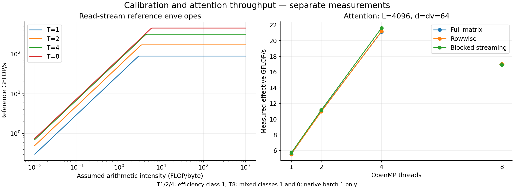
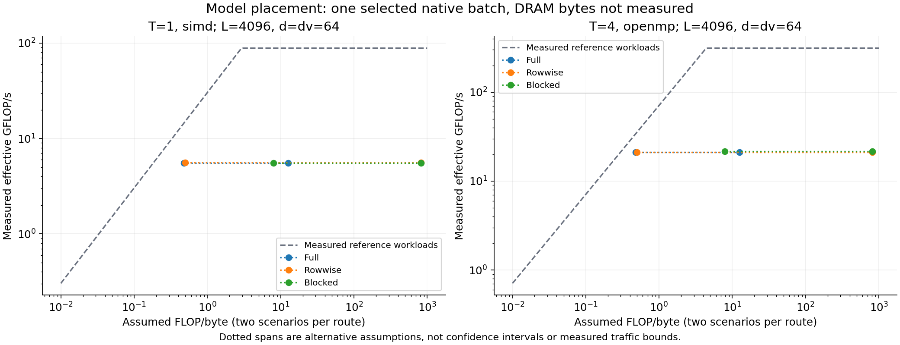

# Machine reference and attention throughput

Left: measured AVX2 mul+add and read-stream reference curves. Right: native attention throughput from the selected grid. The panels use separate experiments; these are not verified hardware limits.

`traffic_scenarios.csv` contains two assumed DRAM traffic scenarios per available route for L=4096, d=dv=64. Both assume cold ordinary output stores (including RFO). Full/row scenarios retain the original score-spill/cached-row assumptions. Blocked scenarios assume cached query, score and online state; K/V arrive once or once per query block. Bq/Bk and scratch capacity are recorded separately. These scenarios are not measured lower/upper bounds. Actual DRAM bytes are unknown.

See [model and calibration details](../../../docs/ROOFLINE_REFERENCE.md).
