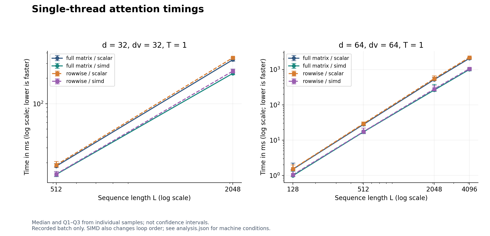
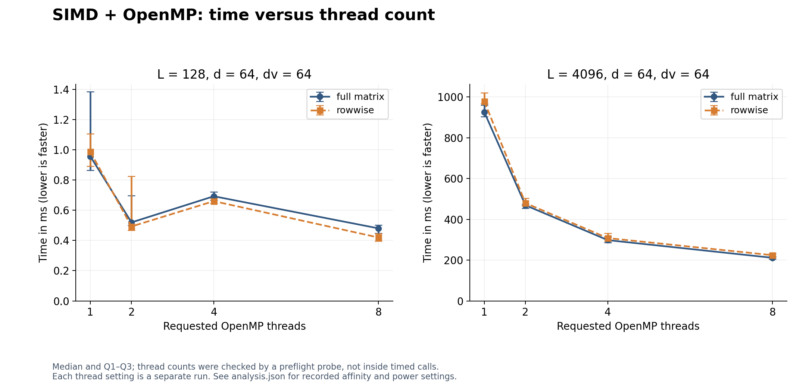
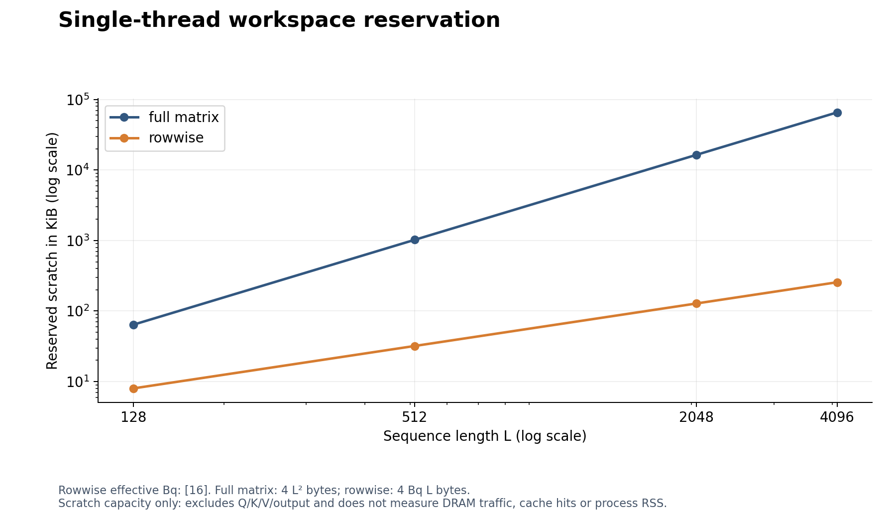

# First-run comparisons

Generated from the saved 21 October grid: 14 runs, 40 configurations and 800 timings. The analyzer checked each summary against its raw samples. These are the original measurements, not a new benchmark run. Source revision: `2cb8ec5a41212710fa7aae25776d78ee191b7eb0`; Windows, Intel Core Ultra 7 356H, GCC 16.2.0, 10 warm-ups and 20 samples per configuration. Affinity and power mode were uncontrolled.

## Single-thread time

For L=512, d=dv=64, the full-matrix median fell from 27.926 ms (scalar) to 17.115 ms (SIMD), a ratio of 1.632. Rowwise fell from 29.430 to 17.4055 ms, a ratio of 1.691. These compare the integrated implementations: SIMD also changes the PV loop order, so the ratios do not isolate vector instructions. The full/rowwise differences in this case are small relative to the observed spread; repeat before claiming a consistent winner.

## Thread count

At L=4096, full-matrix OpenMP fell from 925.721 ms with one thread to 211.2915 ms with eight (4.381x); rowwise fell from 978.866 to 224.058 ms (4.369x). Each ratio uses its own OpenMP one-thread baseline. At L=128 the curves are not monotonic: four threads were slower than two in this batch. The data do not establish the cause.

The bars span Q1 to Q3, not confidence intervals. Thread settings were separate runs. `actual_threads` records a preflight team probe, not a probe inside each timed call.

## Workspace

At L=512, single-thread full-matrix reserves 1 MiB and rowwise reserves 32 KiB: 32 times less scratch. At L=4096, the same comparison is 64 MiB versus 0.25 MiB. Rowwise OpenMP reserves a separate Bq-by-L workspace for each thread, reaching 2 MiB at L=4096, T=8. Smaller scratch does not by itself establish lower latency or measured DRAM traffic.

## What to repeat

Start with both L=128 OpenMP routes across T=1/2/4/8, then all four L=2048, d=64 serial variants. The largest IQR/median is 72.4% for L=128 rowwise OpenMP T=2; L=2048 full-matrix SIMD also reaches 53.8%. L=512, d=64 is useful for a follow-up comparison of the four single-thread implementations. Keep separate repeat runs and record power, affinity and background load; twenty calls within one run are not twenty independent experiment sessions.

The [full table and spread ranking](RESULTS.md), [CSV](comparison.csv), and [environment and input hashes](analysis.json) preserve the evidence behind these plots. Blocked streaming remains unavailable. [Reproduce these plots](../../../docs/RESULT_ANALYSIS.md).
