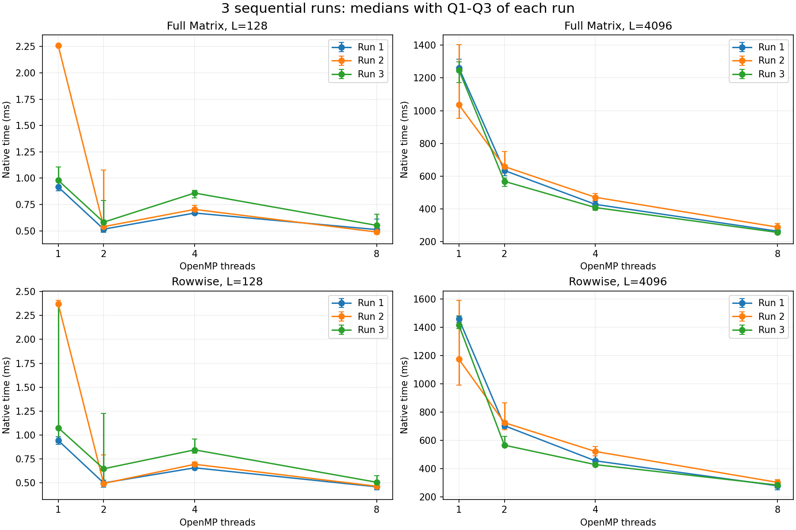

# CPU attention experiments, 22 October 2026

Added three repeat runs of the current six implementations, a PyTorch CPU API
comparison, and arithmetic/read-bandwidth measurements for the roofline analysis.

| Experiment | Completed | Results |
|---|---|---|
| Native scalar/SIMD/OpenMP | 3 runs x 40 configurations; 2,400 timings | [Repeat table](repeats/repeat_comparison.csv) |
| Allocating CPU API | 12 cases x 3 implementations; 720 timings | [API table](pytorch_analysis/comparison.csv) |
| Machine reference | 2 workloads x 4 thread counts x 7 samples | [Calibration](calibration/summary.csv) |

## Repeat runs

All measured outputs passed the FP64 contract before timing and after the final
call. Large L=4096 cases get faster as the OpenMP thread budget increases in all
three runs. Run-to-run variation remains substantial: for L=128 full-matrix T1,
the medians were 0.917, 2.261 and 0.980 ms. L=2048 single-thread SIMD also varied
considerably. These measurements do not support one stable speedup number.

The power-plan snapshots both report High performance. Affinity, frequency and
background load were not controlled. Three sequential runs are not three
independent machines or a confidence interval.

## PyTorch CPU

Single-thread example, d=dv=64; each value is the median of 20 calls:

| L | Full SIMD API (ms) | Row SIMD API (ms) | PyTorch SDPA API (ms) |
|---:|---:|---:|---:|
| 128 | 0.962 | 1.007 | 0.090 |
| 512 | 24.701 | 22.358 | 1.184 |
| 2048 | 372.615 | 409.763 | 19.091 |
| 4096 | 1158.244 | 1274.996 | 61.150 |

PyTorch was faster in these cases. Its profiler identified
`aten::_scaled_dot_product_flash_attention_for_cpu` in all measured cases.
This compares complete allocating calls on the same inputs, not an isolated
SIMD effect. Native benchmark times use a different boundary and stay separate.
The custom T1 API uses serial SIMD; T>1 uses SIMD+OpenMP. The runtimes use
separate thread pools, with passive-wait settings recorded in each case.

## Roofline reference

The measured AVX2 multiply/add reference is 77.93 GFLOP/s at T1 and
365.09 GFLOP/s at T8. Sequential read payload bandwidth is 25.70 and 60.01 GB/s.
The 512 MiB read buffer exceeds this machine's reported 18 MiB L3 cache.
The arithmetic loop was checked in the measured binary: eight vector multiplies
and eight vector adds per iteration, with no FMA.

Attention's actual DRAM traffic was not measured. The
[scenario table](roofline_analysis/traffic_scenarios.csv) explicitly assumes
different K/V cache reuse; neither scenario is a guaranteed traffic bound.
The attention panel uses native run 2, selected before comparing the runs.

## Reproduce and extend

[Native analysis](../../docs/RESULT_ANALYSIS.md) ·
[PyTorch comparison](../../docs/PYTORCH_COMPARISON.md) ·
[Roofline model](../../docs/ROOFLINE_REFERENCE.md)

Measured locally on Windows, Intel Core Ultra 7 356H, 16 physical cores,
GCC 16.2.0 and PyTorch 2.13.0+cpu. Source revisions, exact build settings,
input hashes and per-case conditions are in the saved environment files.
Native runs use 57c0edb; API and calibration use 928e151. No attention kernel
changed between these two revisions. Local API tests and saved-data corruption
checks passed; Linux/macOS, sanitizers and GitHub CI were not run for this increment.

Blocked streaming, its tile tuning and the final three-route interpretation
remain. Its owner can provide the implementation and tests, then it can join
the same measurement pipeline.
