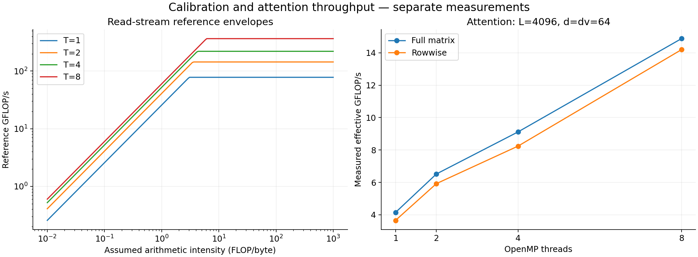

# Machine reference and attention throughput

Left: measured AVX2 mul+add and read-stream reference curves. Right: native attention throughput from the selected grid. The panels use separate experiments; these are not verified hardware limits.

`traffic_scenarios.csv` contains two assumed DRAM traffic models for L=4096, d=dv=64. Both assume cold ordinary output stores (including RFO), full score spilling with 5S traffic, and row scratch retained in cache. They differ in whether K/V arrive once or per query. These scenarios are not measured lower/upper bounds. Actual DRAM bytes are unknown.

See [model and calibration details](../../../docs/ROOFLINE_REFERENCE.md).
